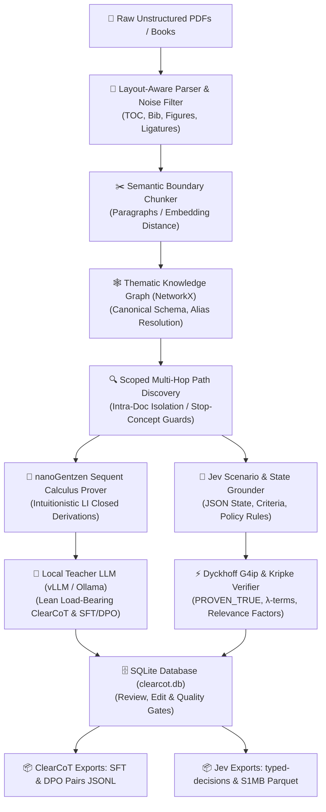

# nanoGentzen ClearCoT & Jev Decision Studio Documentation

Welcome to the comprehensive documentation for **nanoGentzen ClearCoT & Jev Decision Studio**, a 100% local neuro-symbolic dataset factory for transforming unstructured literature (PDFs, technical papers, domain manuals, monographs) into:
1. Logically verified **ClearCoT** reasoning datasets (SFT & contrastive DPO) via intuitionistic sequent calculus.
2. Formally grounded **Jev Decision** datasets conforming to canonical `typed-decisions` and `Open-Jev S1MB` Parquet schemas.

---

## 📚 Documentation Index

| Guide | Description | Target Audience |
| :--- | :--- | :--- |
| [**1. System Architecture**](architecture.md) | High-level system design, modular layers, data structures, and database schema (`samples` and `jev_samples`). | Developers & Architects |
| [**2. Complete Pipeline Walkthrough**](pipeline_walkthrough.md) | Step-by-step walkthrough of all 5 UI tabs from PDF ingestion to ClearCoT and Jev dataset exports. | Practitioners & Data Engineers |
| [**3. LLM Providers & Inference Backends**](llm_providers.md) | Setup and configuration for vLLM, Ollama, OpenAI-compatible APIs, and zero-dependency fallbacks. | MLOps & Local AI Enthusiasts |
| [**4. ClearCoT & nanoGentzen Calculus**](clearcot_and_nanogentzen.md) | Theoretical foundations of Intuitionistic Sequent Calculus ($LI$), Dyckhoff $\mathbf{G4ip}$, Kripke models, and token efficiency. | Researchers & Logicians |
| [**5. nanoGentzen v4**](nanogentzen_v4.md) | The v4 engine in the Studio: statuses, certificates, backends, retraining and re-vendoring. | Developers & Researchers |
| [**6. Logic Integrity**](logic_integrity.md) | What counts as verified: KG relation semantics, assumed bridges, dataset gating, saved graphs. | Everyone generating datasets |
| [**7. Datasets & Samples**](DATASETS_AND_SAMPLES.md) | Field definitions and annotated samples of every export format. | Dataset users |
| [**8. Desktop Testing**](DESKTOP_TESTING.md) | Installing and checking the Studio on a desktop (incl. Windows), manual UI checklist. | Testers |

---

## 🎯 Quick Architecture Map

---

## ⚡ Core Philosophy: Why ClearCoT & Jev?

### 1. ClearCoT for Generative Reasoning
Standard Chain-of-Thought (CoT) generated by modern reasoning models often suffers from:
1. **Token Bloat**: Hundreds of verbose conversational tokens ("Let me think...", "Wait, let's reconsider...") that inflate inference cost without improving accuracy.
2. **Ungrounded Hallucinations**: Plausible-sounding rationalizations that jump across unrelated concepts without evidentiary support.
3. **Formal Incoherence**: Circular reasoning and logical fallacies masked by rhetorical fluency.

**nanoGentzen ClearCoT & Jev Decision Studio** solves this by:
* **Grounding** every proposition in exact document chunks and page provenance.
* **Proving** the deductive chain with **nanoGentzen v4** (intuitionistic logic, G4ip) before prompting the LLM.
* **Enforcing** lean, load-bearing reasoning whose token saving is measured per sample, on top of a proved inference chain.

### 2. Jev for Structured Neuro-Symbolic Decisions
Real-world enterprise decisions require strict adherence to criteria policies, confidence calibration, and causal attribution:
* **Structured State Representation**: Extracts domain facts, flags, and constraints into unambiguous JSON.
* **Formal Decision Policy Rules**: Connects state facts to decisions via propositional implications.
* **Saul Kripke Soundness**: Certifies that candidate decisions are intuitionistically valid (`PROVEN_TRUE`).
* **Curry-Howard Typed $\lambda$-Terms**: Emits constructive proofs as computational terms.
* **Relevance Logic Causal Factors**: Isolates the exact minimal subset of state properties that caused the decision, eliminating irrelevant variables.
